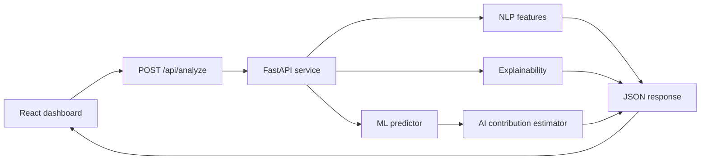

# LexiTrace

Explainable fine-grained AI text detection and authorship analysis platform.

LexiTrace is a working college-project MVP for classifying text into four authorship categories while showing linguistic signals, class probabilities, highlighted evidence, and a clear disclaimer that AI detection is probabilistic.

## Problem Statement

AI text detectors often return a single opaque score. LexiTrace aims to make detection more useful and responsible by combining a four-class taxonomy with explainable evidence and linguistic feature analysis.

## Proposed Solution

The prototype combines:

- A React + TypeScript dashboard for text analysis.
- A FastAPI backend exposing health and analysis endpoints.
- An ML inference abstraction that supports development fallback mode now and fine-tuned transformer models later.
- NLP feature extraction for readability, vocabulary diversity, burstiness, punctuation, passive voice, POS distribution, and estimated perplexity.
- Explainability output for important sentences and tokens.

## Four-Class Taxonomy

| Label | Class |
| --- | --- |
| 0 | Human |
| 1 | AI-generated |
| 2 | AI-polished human |
| 3 | Humanized AI |

## Architecture



## Technology Stack

- Frontend: React, TypeScript, Vite, Tailwind CSS, Recharts
- Backend: Python, FastAPI, Pydantic, pytest
- ML: Hugging Face Transformers, PyTorch, scikit-learn
- NLP: lightweight development implementation with optional spaCy/textstat expansion

## Installation

Backend:

```powershell
cd C:\Users\aryan\LexiTrace\backend
python -m venv .venv
.\.venv\Scripts\Activate.ps1
pip install -r requirements.txt
```

Frontend:

```powershell
cd C:\Users\aryan\LexiTrace\frontend
npm install
```

## Running Backend

```powershell
cd C:\Users\aryan\LexiTrace\backend
$env:LEXITRACE_MODE="development"
uvicorn app.main:app --reload --port 8000
```

## Running Frontend

```powershell
cd C:\Users\aryan\LexiTrace\frontend
npm run dev
```

Open the Vite URL, usually `http://localhost:5173`.

## ML Setup

Development mode is the default and does not claim a trained model exists. Set `LEXITRACE_MODE=model` when a fine-tuned model directory is available.

Use Python 3.11 or 3.12 for ML training dependencies because some ML libraries may not publish wheels for the newest Python releases immediately.

```powershell
cd C:\Users\aryan\LexiTrace
python -m venv .mlvenv
.\.mlvenv\Scripts\Activate.ps1
pip install -r ml/requirements.txt
```

Expected model path:

```text
ml/models/deberta-v3-base-finetuned/
```

Train later with:

```powershell
cd C:\Users\aryan\LexiTrace
python ml/training/train.py --data ml/data/dataset.csv --output-dir ml/models/deberta-v3-base-finetuned
```

## Dataset Setup

Expected CSV format:

```csv
text,label
"Human written example...",0
"AI generated example...",1
"Human text improved by AI...",2
"AI text rewritten to appear human...",3
```

Datasets such as APT-Eval, RAID, and Beemo can be integrated later by converting them into the same `text,label` format. Do not commit large datasets.

## API Documentation

See [docs/api.md](docs/api.md).

## Testing

Backend:

```powershell
cd C:\Users\aryan\LexiTrace\backend
pytest
```

Frontend:

```powershell
cd C:\Users\aryan\LexiTrace\frontend
npm run build
```

## Limitations

- Development mode uses transparent heuristics, not a validated detector.
- The AI contribution score is an MVP approximation, not scientific proof.
- SHAP and Captum are scaffolded for future model-backed explainability; fallback explanations are labeled as development explanations.

## Future Work

- Fine-tune DeBERTa-v3-base and RoBERTa-base on a balanced four-class dataset.
- Add SHAP and Integrated Gradients for model-backed explanations.
- Add authentication and project history.
- Add dataset import tooling and experiment tracking.
  ## Installation & Setup

### Prerequisites

Install the following before running LexiTrace:

- Python **3.11** or **3.12**
- Node.js **18+**
- npm (comes with Node.js)
- Git

### 1. Clone the Repository

```bash
git clone https://github.com/palak700/LexiTrace.git
cd LexiTrace
```

---

### 2. Backend Setup

Navigate to the backend folder.

```bash
cd backend
```

Create and activate a virtual environment.

**Windows (PowerShell)**

```powershell
python -m venv .venv
.\.venv\Scripts\Activate.ps1
```

**Windows (Command Prompt)**

```cmd
python -m venv .venv
.venv\Scripts\activate
```

**Linux/macOS**

```bash
python3 -m venv .venv
source .venv/bin/activate
```

Install Python dependencies.

```bash
pip install -r requirements.txt
```

---

### 3. Frontend Setup

Open a new terminal and move to the frontend folder.

```bash
cd frontend
npm install
```

---

## Running the Project

### Start Backend

```powershell
cd backend
$env:LEXITRACE_MODE="development"
uvicorn app.main:app --reload --port 8000
```

Backend runs on:

```text
http://127.0.0.1:8000
```

---

### Start Frontend

Open another terminal.

```bash
cd frontend
npm run dev
```

Frontend runs on:

```text
http://localhost:5173
```

Open the frontend URL in your browser and start analyzing text.
