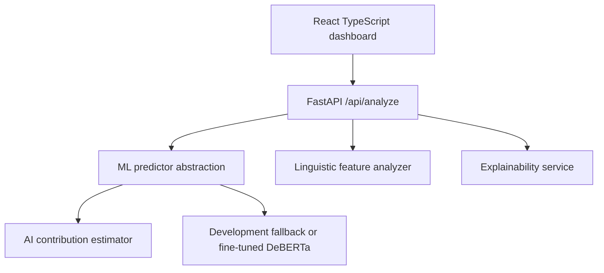

# Architecture

LexiTrace uses a simple local full-stack architecture.

## Components

- `frontend`: Dashboard, API client, charts, highlighted evidence.
- `backend`: FastAPI routes, schemas, orchestration service, feature analysis.
- `ml`: preprocessing, training, evaluation, inference, contribution estimation.
- `data`: small sample data and expected dataset format.

## Development Mode

`LEXITRACE_MODE=development` runs a transparent heuristic predictor. This exists only so the complete app can be demonstrated before training is finished.

## Model Mode

`LEXITRACE_MODE=model` attempts to load a fine-tuned model from `LEXITRACE_MODEL_PATH`. The intended primary model is `microsoft/deberta-v3-base`; RoBERTa-base can be trained as a baseline with the same four-label schema.
